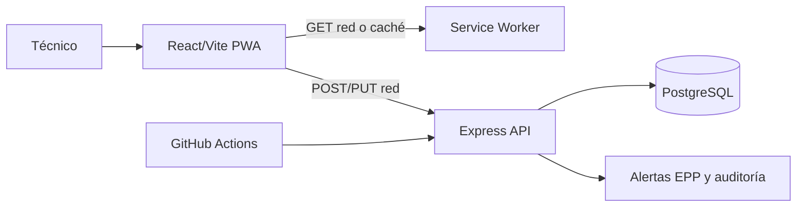
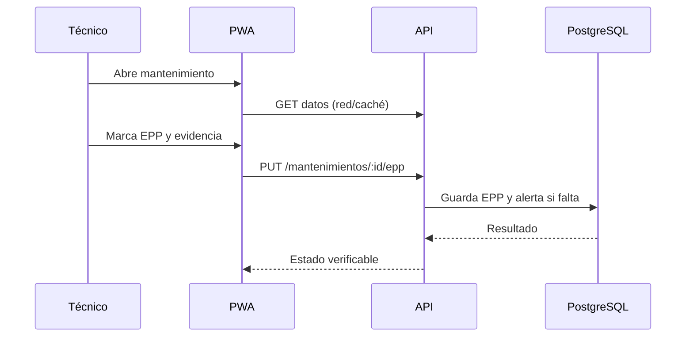

# Aportes tecnológicos para Seminario

## Contexto

RickySafe Maintenance controla mantenimientos de juegos, protocolos, EPP, evidencias, validaciones y auditoría para Rickylandia.

## Aporte 1: PWA y caché controlada

Se agregó una experiencia instalable para técnicos en campo en `frontend/public/manifest.webmanifest`, `frontend/public/icon.svg` y `frontend/public/sw.js`, registrada desde `frontend/src/main.jsx`. El service worker usa network-first para recursos GET: intenta obtener la versión actual y conserva una copia para abrir la última interfaz cuando la conexión falla. Nunca cachea POST/PUT, tokens ni operaciones de escritura; por eso no presenta como guardado un EPP que no llegó al servidor.

Verificación: ejecutar `npm run build` en `frontend`, servir `frontend/dist` desde localhost o HTTPS, instalar la aplicación y repetir la apertura sin red.

## Aporte 2: pruebas de integración de API

Se agregó `backend/test/api-smoke.test.js` con Supertest y Node Test Runner. Los casos ejercitan el `app` Express real y comprueban salud del servicio, protección de rutas sin token y respuesta JSON estable para rutas inexistentes. El workflow ejecuta `npm run test:api` en cada push y pull request. La suite es una base extensible para añadir los escenarios de EPP, horas máximas y persistencia contra PostgreSQL de pruebas.

## Estado previo, decisiones y límites

Previo: React/Vite, API Express/PostgreSQL, autenticación, EPP, evidencias, reportes y build CI. Agregado: instalación PWA, fallback de lectura y pruebas automatizadas de API. Se descartó cachear respuestas mutables porque puede mostrar estados obsoletos; las escrituras requieren red. La PWA exige cambiar `CACHE` al publicar una versión incompatible y las pruebas de base de datos requieren un PostgreSQL disponible en CI.

## Arquitectura

## Flujo crítico

